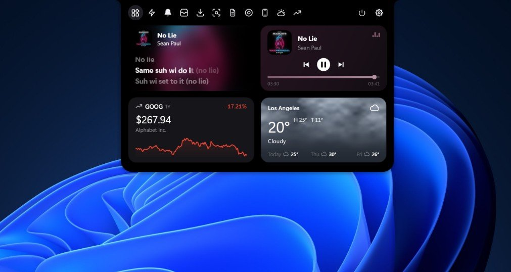
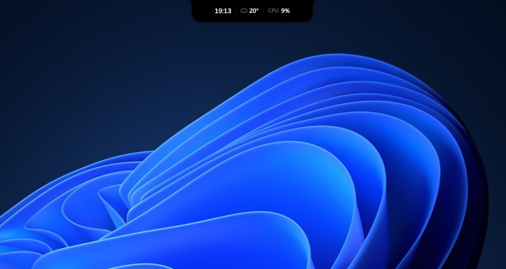
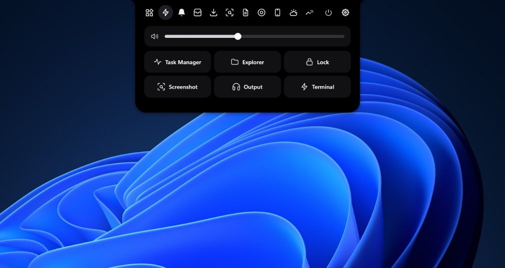

<div align="center">



<br />

# FreeNotch

**A calm, native Dynamic Island-style command surface for Windows 11 — built with C# and WPF (.NET 10).**

[](https://apps.microsoft.com/store/detail/9NWJZKMB0ZFC?cid=DevShareMCLPCS)
[](https://github.com/Foxtrott7/FreeNotch/releases)
[](https://github.com/Foxtrott7/FreeNotch/actions/workflows/ci.yml)
[](LICENSE)
[](https://dotnet.microsoft.com/download/dotnet/10.0)

[Get it from Microsoft Store](https://apps.microsoft.com/store/detail/9NWJZKMB0ZFC?cid=DevShareMCLPCS) · [GitHub Releases](https://github.com/Foxtrott7/FreeNotch/releases/latest) · [Privacy Policy](PRIVACY.md) · [Security Policy](SECURITY.md) · [Build from Source](#build-from-source)

</div>

---

FreeNotch turns the top edge of your Windows 11 screen into an adaptive, low-distraction command surface. Media controls, live widgets, system utilities, and productivity tools live inside a single GPU-accelerated OLED shell that stays out of your way when you work or game.

## Preview

| Collapsed Pill | Control Center |
| :---: | :---: |
|  |  |

## Core Principles

- **Local-First & Zero Telemetry**: No user accounts, no ads, no analytics, and no crash-reporting servers. Settings (`settings.json`), local databases (`notch.db`), and diagnostic logs (`error.log`) remain strictly on your device under `%AppData%\WindowsNotch\`.
- **Strict Opt-In Networking**: Every online feature (Weather, Synced Lyrics, Finance, Favicons, Online File Share) is **disabled by default** and connects only after explicit user consent.
- **No Admin Rights Needed**: Runs with an `asInvoker` manifest — both the per-user installer and the portable build work without administrator privileges.
- **Calm, Adaptive Motion**: 60–240 Hz adaptive animations (`prefers-reduced-motion` aware) with automatic fullscreen suppression over games and videos.

---

## Key Features

| Area | Highlights |
|---|---|
| **2×2 Bento Dashboard** | Reorderable widget grid with Long-Press Jiggle-Mode & Module Store, Calendar / Tasks / Notes, Stopwatch & Focus Timer, Custom App Carousel, and CPU / RAM / GPU metrics |
| **Media & Synced Lyrics** | Windows GSMTC media controls with browser hover-preview protection and time-synced karaoke lyrics (optional LRCLIB opt-in, pin-to-expand view) |
| **Weather & Finance** | Dedicated full tabs and synced Bento tiles — Open-Meteo weather with animated atmospheric effects; Finance watchlist with synced ranges (`Live`, `1D`, `1W`, `1M`, `1Y`, `5Y`, `ALL`) |
| **Control Center** | Customizable quick-action grid with Jiggle-Mode, built-in **Calculator** (full keyboard support), per-app **WASAPI Sound Mixer**, Bluetooth / Wi-Fi / Night Light toggles, and audio output switcher |
| **Header Power Menu** | Quick access next to Settings: Quit, Sleep, double-click confirmation for Restart & Shut down, and a **Power Scheduler** (*Shut down*, *Restart*, *Sign out*, *Sleep* at a chosen time or `+15m`/`+30m`/`+1h` preset) |
| **Productivity & Capture** | 5-slot drag-and-drop **File Tray**, SQLite **Clipboard History**, **Screen OCR & QR Scanner**, **Screen Capture** (WGC + WASAPI audio), **Downloads** monitor, **Notifications** history & filters, and LAN **Phone File Transfer** via QR |
| **Personalization** | Unified OLED Dark UI, 14 accent presets + custom color/gradient editor, 8 screen positions, modular collapsed/hover info slots, compact idle mini-pill mode, *Work / Complete / Gaming* onboarding profiles, and bilingual UI (**English** & **German**) |

---

## Download & Install

> All builds are **self-contained** (`.NET 10` runtime included) and require **no administrator rights**.

### Option 1: Microsoft Store *(Recommended)*

Install directly from the **[Microsoft Store](https://apps.microsoft.com/store/detail/9NWJZKMB0ZFC?cid=DevShareMCLPCS)**:
- **Microsoft-signed MSIX package**: No SmartScreen warnings and compatible with Windows 11 Smart App Control.
- **Automatic updates** via the Microsoft Store and native Windows `StartupTask` auto-start support.

### Option 2: Direct Download (GitHub Releases)

1. Go to the **[Latest Release](https://github.com/Foxtrott7/FreeNotch/releases/latest)** page and choose your package:

   | Package | Best for | Details |
   |---|---|---|
   | **`FreeNotch-v*-win-x64-setup.exe`** | Per-user installer | Per-user Inno Setup installer (`%LocalAppData%\Programs\FreeNotch`), English & German wizard, Start Menu shortcut, automatic stop of running instances on update, and standard Windows *Apps & Features* uninstall |
   | **`FreeNotch-v*-win-x64-portable.zip`** | No installation | Extract anywhere and launch **`FreeNotch.exe`** directly |

2. *(Recommended)* Verify the file integrity against **`SHA256SUMS.txt`** from the same release:
   ```powershell
   Get-FileHash .\FreeNotch-v*-win-x64-setup.exe -Algorithm SHA256
   ```

> **Note on Unsigned GitHub Release Builds**
>
> Direct downloads from GitHub Releases (`setup.exe` and portable `.zip`) are currently **unsigned** — for a signed install without warnings, use the **[Microsoft Store](https://apps.microsoft.com/store/detail/9NWJZKMB0ZFC?cid=DevShareMCLPCS)**:
> - **Windows SmartScreen**: On first launch, Windows may display *"Windows protected your PC"*. After verifying the SHA-256 checksum against `SHA256SUMS.txt`, click **More info → Run anyway**.
> - **Windows 11 Smart App Control**: If Smart App Control is set to *On* (enforcement mode), Windows blocks unsigned executables without a per-app override. Use the Microsoft Store version or build from source below.

---

## Security, Privacy & Build Transparency

- **Hardened Local Services**: `PhoneTransferService` sanitizes uploaded filenames against path traversal and reserved Windows device names, verifies directory containment, caps concurrent connections, and validates tokens using `CryptographicOperations.FixedTimeEquals`. External links opened from OCR or Clipboard History enforce `http`/`https` allowlisting; all SQLite queries are parameterized.
- **Automated CI Verification**: Every push and pull request is built and verified (localization key parity, settings normalization, security checks) via [`.github/workflows/ci.yml`](.github/workflows/ci.yml).
- **Reproducible GitHub Releases**: Release binaries, the Inno Setup installer, and `SHA256SUMS.txt` are built cleanly from tagged commits on `master` via [`.github/workflows/release.yml`](.github/workflows/release.yml).
  - **Maintainer**: [@Foxtrott7](https://github.com/Foxtrott7)
  - **Code Signing Status**: Automated code signing (e.g., via SignPath) is prepared in the release workflow for future signed releases.
- **Policies**: Full details on data handling and vulnerability reporting are documented in [PRIVACY.md](PRIVACY.md) and [SECURITY.md](SECURITY.md).

---

## Build from Source

**Requirements**: Windows 10/11 (x64), [.NET 10 SDK](https://dotnet.microsoft.com/download/dotnet/10.0), and optionally [Inno Setup 6](https://jrsoftware.org/isinfo.php) (to build `setup.exe`).

```powershell
# 1. Build
dotnet build WindowsNotch.csproj -v q

# 2. Run unit & security tests
dotnet test tests/WindowsNotch.Tests/WindowsNotch.Tests.csproj

# 3. Package portable ZIP, Inno Setup installer, and SHA256SUMS.txt
#    (add -SkipInstaller if Inno Setup is not installed)
.\scripts\publish-release.ps1
```

### Repository Structure

```text
├── Core/                # Design tokens, module catalog/host, settings, tray icon renderer
├── Modules/             # Feature modules (Widgets, Media, Control Center, FileTray, Finance, etc.)
├── Services/            # Localization, SQLite storage, GSMTC media, weather, lyrics, power scheduler
├── UI/                  # Notch shell, power menu, settings window, onboarding, localization
├── Resources/Lang/      # Embedded translations (en.json, de.json)
├── installer/           # Per-user Inno Setup script (FreeNotch.iss) & Winget manifest templates
├── scripts/             # Release publish & packaging script (publish-release.ps1)
├── tests/               # xUnit test suite (WindowsNotch.Tests)
└── .github/workflows/   # CI and Release workflows
```

---

## Known Issues & Limitations

- **Unsigned GitHub Releases**: Direct downloads from GitHub Releases (`setup.exe` / portable `.zip`) are currently unsigned and may trigger a Windows SmartScreen prompt on first launch (verify checksums via `SHA256SUMS.txt`), and cannot run when Windows 11 Smart App Control is in enforcement mode. Install via the **[Microsoft Store](https://apps.microsoft.com/store/detail/9NWJZKMB0ZFC?cid=DevShareMCLPCS)** for a Microsoft-signed build.
- **System Limits**: Bluetooth battery reporting depends on the device's Windows driver; Windows notification listening uses a 500 ms polling fallback when running unpackaged.

---

## Contributing & License

- Bug reports and pull requests are welcome on [GitHub](https://github.com/Foxtrott7/FreeNotch). Please keep changes focused, bilingual (`en.json` & `de.json`), and covered by `dotnet test`.
- Security issues must be reported privately via [GitHub Security Advisories](https://github.com/Foxtrott7/FreeNotch/security/advisories/new) (see [SECURITY.md](SECURITY.md)).
- FreeNotch is source-available software licensed under the **[PolyForm Noncommercial License 1.0.0](LICENSE)** — free to inspect, fork, and modify for non-commercial use; commercial use, resale, or paid redistribution requires prior permission.
