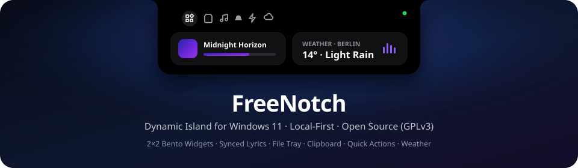

<p align="center">
  
</p>

<p align="center">
  <a href="https://github.com/Foxtrott7/FreeNotch/releases">
    
  </a>
  <a href="https://github.com/Foxtrott7/FreeNotch/actions/workflows/ci.yml">
    
  </a>
  <a href="LICENSE">
    
  </a>
</p>

<p align="center">
  A calm, native Dynamic Island-style notch for Windows 11 written in C# and WPF (.NET 10).
</p>

---

## Features

- **Widgets & Media**: 2×2 drag-and-drop bento grid with Windows media controls, synced lyrics, weather, calendar/notes/tasks, stopwatch, focus timer, and CPU/RAM/GPU stats.
- **Notifications & Quick Controls**: Live toast history with per-app mute filters, audio device switcher, Bluetooth battery status, and quick toggles.
- **Productivity Tools**: 5-slot drag-and-drop file tray, searchable clipboard history, region OCR/QR capture, screen recording with audio, browser download progress, and local Wi-Fi phone file transfer.
- **Customization**: 4 themes (`Dark`, `DarkGlass`, `Light`, `LightGlass`), 15 accent presets + custom gradient picker, 8 screen positions, multi-monitor DPI support, and automatic hiding over fullscreen apps/games.
- **Languages**: English and German.

## Privacy

Everything runs locally with no accounts, ads, or telemetry. Settings, logs, and local databases stay on your PC in `%AppData%\WindowsNotch\`.

Online features (weather, lyrics, website favicons, finance quotes, temporary phone-transfer uploads) are **off by default** and only connect if you explicitly turn them on. See [PRIVACY.md](PRIVACY.md) and [SECURITY.md](SECURITY.md) for details.

## Download & Install

No admin rights required.

1. Download **`FreeNotch-v*-win-x64-portable.zip`** from [Releases](https://github.com/Foxtrott7/FreeNotch/releases) (or `framework-dependent.zip` if you already have the .NET 10 Desktop Runtime).
2. Extract the ZIP.
3. Run `FreeNotch.exe` directly, or run `Install.cmd` to install to `%LocalAppData%\Programs\WindowsNotch` with a Start Menu entry.

Checksums are in `SHA256SUMS.txt`.

Free code signing provided by [SignPath.io](https://signpath.io/), using a certificate by [SignPath Foundation](https://signpath.org/).

## Build from Source

Requires Windows 10/11 (x64) and the [.NET 10 SDK](https://dotnet.microsoft.com/download/dotnet/10.0).

```powershell
dotnet build WindowsNotch.csproj -v q
dotnet test tests/WindowsNotch.Tests/WindowsNotch.Tests.csproj
.\scripts\publish-release.ps1
```

## License

[GPLv3](LICENSE)
